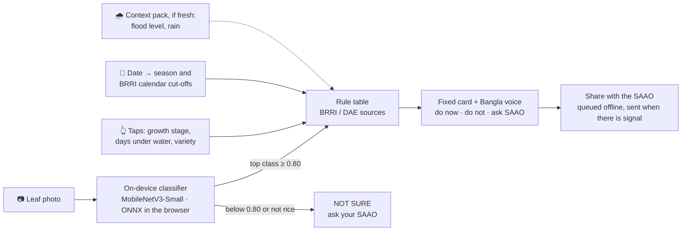

<div align="center">

# Agronomy

**A photo, an answer, and an honest "not sure".**<br>
An offline advisor for rice farmers in flood-prone Bangladesh: an on-device leaf classifier plus BRRI's own rules, in Bangla, with a hand-off to the local agriculture officer whenever it isn't sure.


<sub>The golden path from <a href="DEMO.md"><code>DEMO.md</code></a>, animated. The three numbers are measured (<a href="docs/results.md"><code>docs/results.md</code></a>); the two predictions on the phone are illustrative.</sub>

</div>

---

## The problem

Rahim grows Aman rice on about 1 ha in Sirajganj, on the Jamuna floodplain. He owns a cheap Android phone (Tk 6,000 class); signal in the village is patchy and data costs money. One agriculture officer (SAAO) serves roughly 900 to 2,000 families, and the August 2024 floods damaged about 200,000 ha of Aman rice (USDA GAIN; sources in [`DEMO.md`](DEMO.md)). After a flood or when leaves turn spotty, he has to decide alone: wait, re-plant, or ask for help.

The brief ([World Bank, Challenge 04](docs/challenges/04-small-ai-for-development-worldbank.md)) asked for a small AI tool that runs on a device the farmer already owns, works **offline**, speaks a **local language**, and never pretends to be sure.

## How it decides

No generative model touches the farmer's answer. Every path ends in a fixed, reviewed card.



- **Answers only when it should.** The threshold (min probability 0.80, temperature 0.85) was fitted on validation so that answers are right 95% of the time there; it was never tuned on the test set.
- **Knows what it doesn't know.** A `not_rice` class and the threshold together turned **60 of 60** unseen bean leaves into "not sure".
- **Shows its work.** Each card names the inputs used, the rule's source and year, and how fresh the weather data is.

Details: [`docs/architecture.md`](docs/architecture.md) · rules: [`docs/advisor-rules.md`](docs/advisor-rules.md) · cards: [`docs/action-cards.md`](docs/action-cards.md)

## Results

Model v2: MobileNetV3-Small (ImageNet-pretrained), fully fine-tuned for 12 epochs, 7 classes including `not_rice`, ONNX fp32 **6.1 MB** (int8 was rejected: it agreed with fp32 on only 15% of photos).

| | Validation (same sources, unseen leaf clusters) | **Held-out dataset** (AgML_BD, never seen in training) |
|---|---:|---:|
| Macro-F1 | 0.912 | — |
| Answers (coverage) | 76.5% | 63.4% |
| **Right when it answers** | **95.1%** | **74.4%** |
| Overall top-1 accuracy | — | 57.2% |
| Calibration error (ECE) after temperature scaling | 0.015 | — |
| Unseen bean leaves → "not sure" | — | **100%** (60/60) |

**Read the gap, not just the top line.** Leave-one-dataset-out tests show that rice-leaf models trained on some farms transfer poorly to a new farm, camera and team, the same pattern the literature reports. A disease that comes from a single dataset (tungro, bacterial leaf blight) can't be learned without it. That's why the photo is never the final word: the app adds the farmer's context, never shows certainty, and routes to the SAAO. Full tables: [`docs/results.md`](docs/results.md).

## Data

14,134 rice-leaf photos from four Bangladeshi field datasets for training and validation, a fifth Bangladeshi dataset held out for testing, and 747 non-rice Bangladeshi leaves (chilli, banana, bean, lemon, jackfruit) to teach "this isn't a rice leaf". All CC BY 4.0 or CC0; 2,302 near-duplicates grouped so they can't leak between splits.

**What the data does not cover**, stated on purpose: flood and drought-stress photos, planthopper and stem-borer damage, panicle diseases, seedlings, the Boro season, nutrient deficiencies, whole-field photos, and cheap low-resolution cameras. Sources, licences and counts: [`docs/data.md`](docs/data.md).

## What's in this repo

| Part | Where | Status |
|---|---|---|
| Data download, cleaning, de-duplication | [`ml/`](ml) | ✅ |
| Training, calibration, leave-one-dataset-out evaluation, ONNX export | [`ml/`](ml) | ✅ |
| Shipped model + threshold + labels for the app | [`frontend/public/model/`](frontend/public/model) | ✅ v2 |
| Leaf-health knowledge base | [`frontend/public/data/knowledge.json`](frontend/public/data) | ✅ fact-checked, Bangla pending review |
| After-flood rule table and action cards | [`docs/advisor-rules.md`](docs/advisor-rules.md), [`docs/action-cards.md`](docs/action-cards.md) | drafted with sources, needs agronomist review |
| Backend (FastAPI + SQLModel) and app (Next.js 16 PWA) | [`backend/`](backend), [`frontend/`](frontend) | starter; context pack, sync and the farmer UI are in progress |

## Run

Reproduce the model (Python 3.11+; full run order in [`ml/README.md`](ml/README.md)):

```bash
python3 -m venv .venv-ml && source .venv-ml/bin/activate
pip install -r ml/requirements.txt
cd ml
python fetch_data.py                      # rice datasets → data/raw/
python fetch_notrice.py                   # non-rice leaves for the not_rice class
python prepare.py --raw ../data/raw --out ../data
python train.py --manifest ../data/manifest.csv --mode finetune --epochs 12 --out ../runs/ft
python eval.py --run ../runs/ft --nonrice ../data/nonrice
python export.py --run ../runs/ft --out ../frontend/public/model --check-images ../data/clean
```

Run the app and API locally:

```bash
make setup     # venv, pip, npm, copies .env files
make dev       # backend :8000 + frontend :3000
make smoke     # tests + live end-to-end check + frontend build
```

<details>
<summary><b>Deploy notes</b></summary>

Backend: Railway or Render (start command `uvicorn app.main:app --host 0.0.0.0 --port $PORT`, root `backend/`). Frontend: Vercel, root `frontend/`, set `NEXT_PUBLIC_API_URL`. Add the Vercel URL to `FRONTEND_ORIGINS` (or set `FRONTEND_ORIGIN_REGEX=https://.*\.vercel\.app`) on the backend.

`NEXT_PUBLIC_API_URL` is baked in at build time, so redeploy the frontend after changing it. The SQLite file on Railway/Render is wiped on every redeploy unless you attach a volume; seed demo data on startup instead.

</details>

## Responsible AI

- **No LLM in the farmer's path.** The classifier recognises; deterministic rules decide; fixed cards speak.
- **"Not sure" is a first-class answer**, and the human (the farmer, then the SAAO) always decides.
- **No pesticide names or doses.** Spray questions go to the SAAO.
- **Shared cases carry no name and no GPS**; photos are shared only with explicit consent.

## Team

**BengaliPharaohs** at Hack-Nation 7, Vienna hub, 3–4 October 2026.

| | |
|---|---|
| **Omar Kassem** ([@omarjku](https://github.com/omarjku)) | model, data, evaluation, backend |
| **Zoha** | app, Bangla voice and copy, pitch |

<details>
<summary><b>How we worked</b></summary>

- [`CLAUDE.md`](CLAUDE.md): rules, status and decisions, loaded by Claude Code every session
- [`LESSONS.md`](LESSONS.md): what won Hack-Nation 6 and how to repeat it
- [`DEMO.md`](DEMO.md): the golden path · [`PITCH.md`](PITCH.md): pitch and video plan
- [`contract/api.md`](contract/api.md): the backend/frontend contract
- [`.claude/`](.claude): agents (`reviewer`, `researcher`) and commands (`/demo-check`, `/review`, `/research`, `/cut-scope`, `/idea-score`)

</details>

<sub>The animation at the top is drawn frame by frame in code (canvas → headless Chromium → ffmpeg): <a href="https://github.com/omarjku/omarjku/tree/main/motion">source</a>.</sub>
